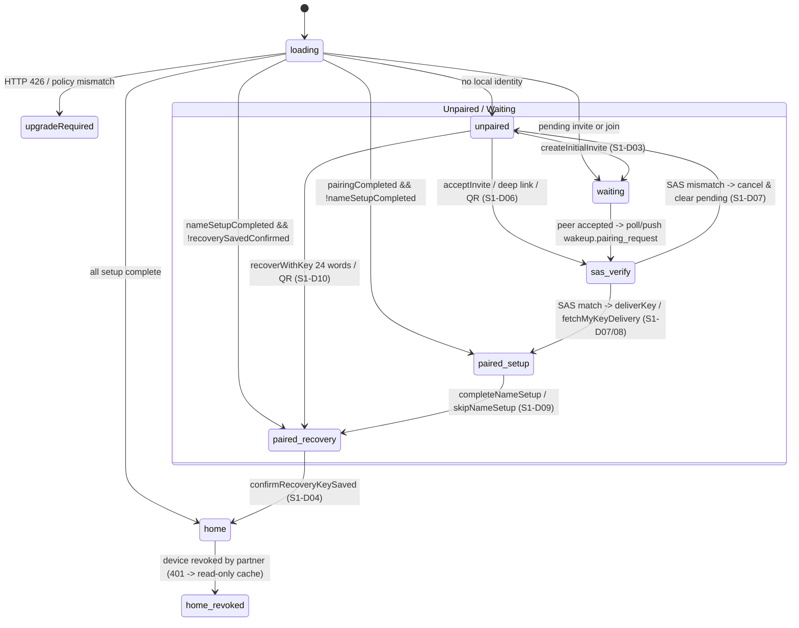

# Macchina a stati dell'Enrollment — Deep Sky (`S1-CTR-01`)

**Versione protocollo enrollment:** `1` (`X-Protocol-Version: 1`)  
**Riferimenti:** `F-01`, `F-20`, `F-19`, `S-01..S-07`, `AR-02`, `S1-D02..S1-D16`, `S1-SRV-01`, `S1-SRV-02`.

---

## 1. Stati globali del client (`AppBootPhase`)

| Stato | Significato | Schermata (`DeepSkyApp`) |
| :--- | :--- | :--- |
| `loading` | Avvio locale, lettura keystore e verifica compatibilità (`X-Client-Version-Code`, `X-Protocol-Version`) | Splash notturno (`loading-page`) |
| `upgradeRequired` | Server ha risposto `426 Upgrade Required` (`CLIENT_UPGRADE_REQUIRED` / `PROTOCOL_UPGRADE_REQUIRED`) | `UpgradeRequiredPage` (`S1-D13` bloccante gentile) |
| `unpaired` | Nessuna coppia locale | `OnboardingPage` (`Invita` / `Unisciti` / `Recupera`) |
| `waiting` | Invito iniziale attivo o richiesta join pendente in attesa di verifica SAS | `CodeVerificationPage` (se SAS pronto) o `OnboardingPage` (`S1-D05`) |
| `paired` + `needsSpaceSetup` | Chiave di coppia ricevuta, nome spazio non ancora confermato | `SpaceSetupPage` (`S1-D07-2` / `S1-D09`) |
| `paired` + `needsRecoveryKeySetup` | Nome confermato, salvataggio Recovery Key non ancora confermato (`S-06`) | `RecoveryKeySetupPage` (`S1-D04`) |
| `paired` (pronto) | Tutti i prerequisiti chiusi | `HomeShellPage` (`S1-D11`, `S1-D12`, `S1-D13`) |

---

## 2. Diagramma di transizione (Enrollment, Join, Recupero, Revoca)

---

## 3. Lifecycle degli inviti e richieste pendenti (Server)

| Entità / Azione | TTL / Limite | Comportamento |
| :--- | :--- | :--- |
| `POST /api/v1/pairing/invites` | TTL `15m`; `20 req/60s` per IP | Crea `couple` + primo `device` + token monouso hashato |
| `POST /api/v1/pairing/invites/accept` | Rate limit stretto `5 req/60s` per IP (`INVITE_REDEEM`) | Validazione monouso atomica anti-enumerazione con token nel body JSON: mancante/scaduto/già usato/couple sciolta rispondono uniformemente **`409 CONFLICT`**. Invia `wakeup.pairing_request` (`S-02`, nessun nome/testo) al dispositivo approvatore |
| `POST /api/v1/pairing/enrollment-invites` | TTL `15m` | Generato da un dispositivo già attivo nella coppia per arruolare un secondo telefono personale (`F-20`) |
| `PairingCleanupService` | Scheduler `PT5M` | Elimina inviti scaduti (`expiresAt < now - 15m`), challenge scadute (`1h`), nonce scaduti, e revoca automaticamente dispositivi `INVITE_JOIN`/`ENROLLMENT` rimasti senza `KeyDeliveryEntity` dopo `30m` (`S1-SRV-02`) |

---

## 4. Codici errore stabili & mappatura UI (`S1-D14`, `V-08`)

| HTTP / Errore | Codice backend (`ApiError.code`) | Stato / Azione UI (IT / EN senza toni allarmistici) |
| :--- | :--- | :--- |
| `400 BAD_REQUEST` | `BAD_REQUEST` / `VALIDATION_ERROR` | Messaggio chiaro sul campo o link inserito |
| `401 UNAUTHORIZED` | `DEVICE_UNKNOWN` / `DEVICE_REVOKED` / sig error | Su dispositivo già abbinato attiva banner calmo in sola lettura (`revokedDeviceBanner`) preservando la cache locale |
| `404 NOT_FOUND` (key delivery non ancora caricata) | `NOT_FOUND` | Su `CodeVerificationPage` mostra attesa gentile (`joinerAwaitingPartnerApproval`) |
| `409 CONFLICT` (invite accept) | `CONFLICT` | Messaggio uniforme su invito scaduto, già usato o non valido (`inviteUnavailableMessage`) senza rivelare se il token esista |
| `409 CONFLICT` / `404` / `FormatException` (recovery) | `CONFLICT` / `NOT_FOUND` / local validation | Messaggio calmo non enumerante (`recoverCalmFailureMessage`): invita a controllare ordine delle 24 parole e server |
| `426 UPGRADE_REQUIRED` | `CLIENT_UPGRADE_REQUIRED` / `PROTOCOL_UPGRADE_REQUIRED` | Transizione immediata a `UpgradeRequiredPage` (`S1-D13`) con aggiornamento in-app |
| `429 TOO_MANY_REQUESTS` | `RATE_LIMITED` + `Retry-After` | Invita ad attendere qualche secondo prima di riprovare |
| Rete assente / timeout | `SocketException` / offline | `HomeShellPage` passa automaticamente in modalità sola lettura offline (`offlineReadOnlyBanner`) senza perdita di cronologia |
