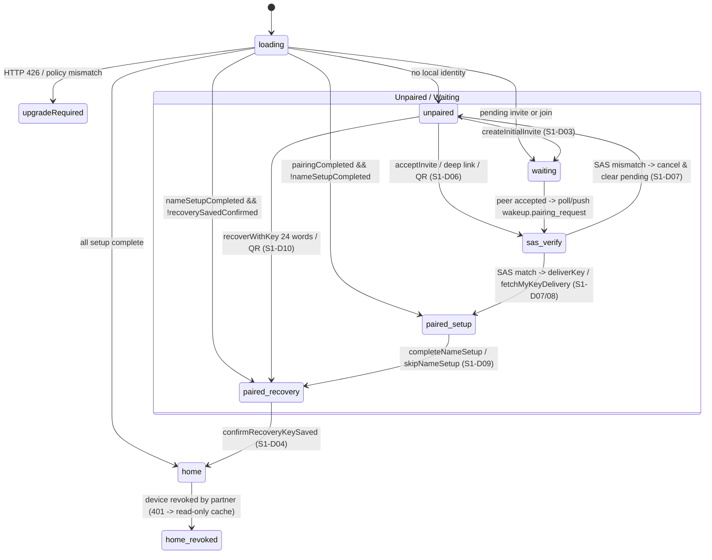

# Enrollment State Machine — Deep Sky (`S1-CTR-01`)

**Enrollment protocol version:** `1` (`X-Protocol-Version: 1`)  
**References:** `F-01`, `F-20`, `F-19`, `S-01..S-07`, `AR-02`, `S1-D02..S1-D16`, `S1-SRV-01`, `S1-SRV-02`.

---

## 1. Global Client States (`AppBootPhase`)

| State | Meaning | Screen (`DeepSkyApp`) |
| :--- | :--- | :--- |
| `loading` | Local startup, keystore read, and compatibility check (`X-Client-Version-Code`, `X-Protocol-Version`) | Night splash (`loading-page`) |
| `upgradeRequired` | Server responded `426 Upgrade Required` (`CLIENT_UPGRADE_REQUIRED` / `PROTOCOL_UPGRADE_REQUIRED`) | `UpgradeRequiredPage` (`S1-D13` gentle blocker) |
| `unpaired` | No local couple | `OnboardingPage` (`Invite` / `Join` / `Recover`) |
| `waiting` | Active initial invite or pending join request awaiting SAS verification | `CodeVerificationPage` (if SAS ready) or `OnboardingPage` (`S1-D05`) |
| `paired` + `needsSpaceSetup` | Couple key received, space name not yet confirmed | `SpaceSetupPage` (`S1-D07-2` / `S1-D09`) |
| `paired` + `needsRecoveryKeySetup` | Name confirmed, Recovery Key backup not yet confirmed (`S-06`) | `RecoveryKeySetupPage` (`S1-D04`) |
| `paired` (ready) | All prerequisites completed | `HomeShellPage` (`S1-D11`, `S1-D12`, `S1-D13`) |

---

## 2. Transition Diagram (Enrollment, Join, Recovery, Revocation)

---

## 3. Lifecycle of Invites and Pending Requests (Server)

| Entity / Action | TTL / Limit | Behavior |
| :--- | :--- | :--- |
| `POST /api/v1/pairing/invites` | TTL `15m`; `20 req/60s` per IP | Creates `couple` + first `device` + hashed one-time token |
| `POST /api/v1/pairing/invites/accept` | Strict rate limit `5 req/60s` per IP (`INVITE_REDEEM`) | Atomic anti-enumeration one-time validation with token in JSON body: missing/expired/already used/dissolved couple all respond uniformly with **`409 CONFLICT`**. Sends `wakeup.pairing_request` (`S-02`, no name/text) to the approving device |
| `POST /api/v1/pairing/enrollment-invites` | TTL `15m` | Generated by an already active device in the couple to enroll a second personal phone (`F-20`) |
| `PairingCleanupService` | Scheduler `PT5M` | Deletes expired invites (`expiresAt < now - 15m`), expired challenges (`1h`), expired nonces, and automatically revokes `INVITE_JOIN`/`ENROLLMENT` devices left without `KeyDeliveryEntity` after `30m` (`S1-SRV-02`) |

---

## 4. Stable Error Codes & UI Mapping (`S1-D14`, `V-08`)

| HTTP / Error | Backend Code (`ApiError.code`) | UI State / Action (IT / EN without alarmist tone) |
| :--- | :--- | :--- |
| `400 BAD_REQUEST` | `BAD_REQUEST` / `VALIDATION_ERROR` | Clear message about the entered field or link |
| `401 UNAUTHORIZED` | `DEVICE_UNKNOWN` / `DEVICE_REVOKED` / sig error | On an already paired device, activates a calm read-only banner (`revokedDeviceBanner`) preserving the local cache |
| `404 NOT_FOUND` (key delivery not yet uploaded) | `NOT_FOUND` | On `CodeVerificationPage`, displays a gentle waiting state (`joinerAwaitingPartnerApproval`) |
| `409 CONFLICT` (invite accept) | `CONFLICT` | Uniform message for expired, already used, or invalid invite (`inviteUnavailableMessage`) without revealing whether the token exists |
| `409 CONFLICT` / `404` / `FormatException` (recovery) | `CONFLICT` / `NOT_FOUND` / local validation | Calm non-enumerating message (`recoverCalmFailureMessage`): prompts to check the order of the 24 words and server |
| `426 UPGRADE_REQUIRED` | `CLIENT_UPGRADE_REQUIRED` / `PROTOCOL_UPGRADE_REQUIRED` | Immediate transition to `UpgradeRequiredPage` (`S1-D13`) with in-app update |
| `429 TOO_MANY_REQUESTS` | `RATE_LIMITED` + `Retry-After` | Prompts to wait a few seconds before retrying |
| Network unavailable / timeout | `SocketException` / offline | `HomeShellPage` automatically switches to offline read-only mode (`offlineReadOnlyBanner`) without losing history |
